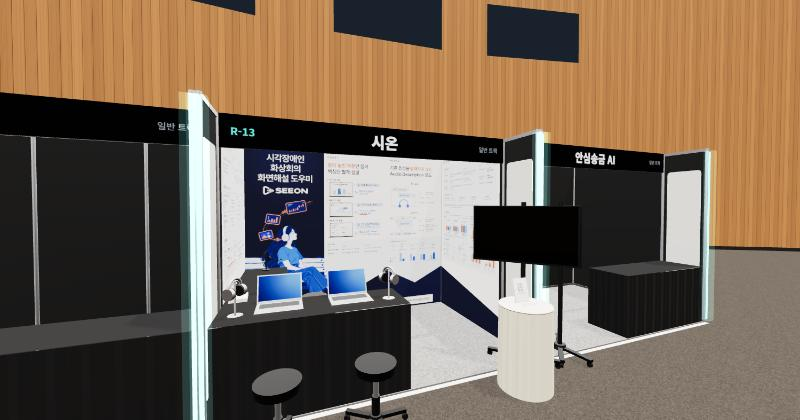

# AI ROOKIE 결선 행사장 3D

배치도를 기준으로 만든 AI ROOKIE 결선 행사장을 직접 걸어 다니며 **R-13 시온(SEEON) 부스**를 둘러보는 3D 공간입니다.

**바로 보기: https://wjywjy719-max.github.io/ai-rookie-hall-3d/**

## 조작 방법

### 휴대폰 (가로·세로 모두 가능)

- 왼쪽 조이스틱: 이동 (끝까지 밀면 달리기)
- 화면 드래그: 둘러보기 (이동하면서 가능)
- 오른쪽 버튼: 전체화면 · 시점 바꾸기 · 점프

### 컴퓨터 (마인크래프트 기본 키와 같음)

| 키 | 동작 |
|---|---|
| 마우스 | 둘러보기 (화면을 클릭하면 시점 고정) |
| W A S D | 이동 |
| 방향키 | 이동하면서 시점 돌리기 |
| Space | 점프, 두 번 누르면 날기 |
| Ctrl 또는 W 두 번 | 달리기 |
| Shift | 웅크리기 |
| F5 | 시점 바꾸기 (1인칭 → 3인칭 뒤 → 3인칭 앞) |
| F1 / F3 | 화면 표시 숨기기 / 좌표 보기 |
| Esc | 게임 메뉴 |
| F11 | 전체화면 |
| 1 / 2 | R-13 앞으로 / R-13에서 행사장 보기 |

## 구성

- 행사장: 배치도 기준 약 74 × 41 m 타원형 홀, 왼쪽 무대
- 부스: AI ROOKIE 39개(R-1~R-39), AI CHAMPION 40개(C-1~C-40), AI 체험존
- 부스 규격: 안치수 2.9 × 2.0 × 2.35 m
- R-13 시온 부스: 현수막 최종본(족자 75차)과 실제 배치대로 놓은 테이블, 노트북, TV 등

`index.html` 파일 하나로 동작하며, 3D 표시는 [three.js](https://threejs.org/)를 사용합니다.
